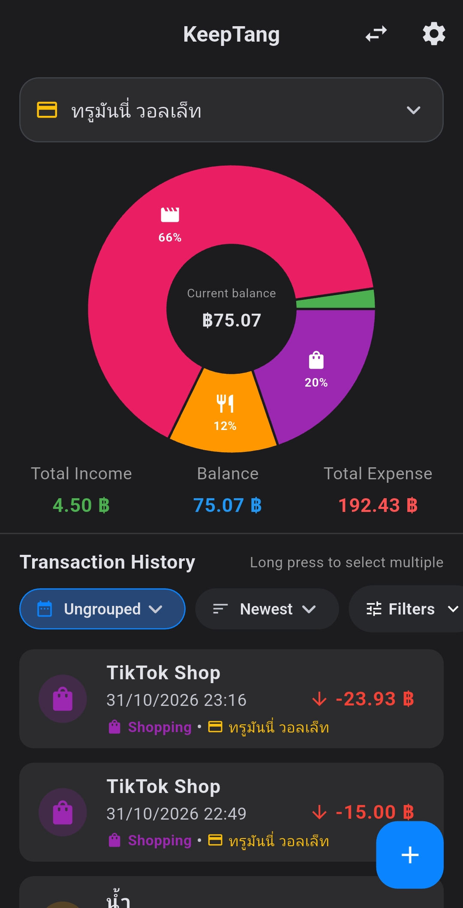
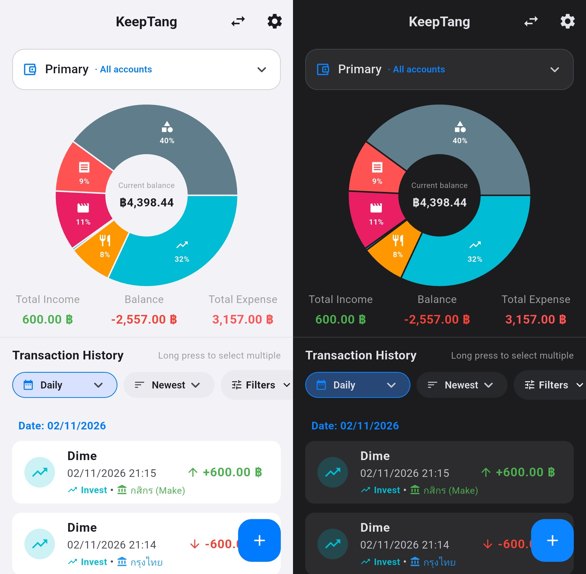
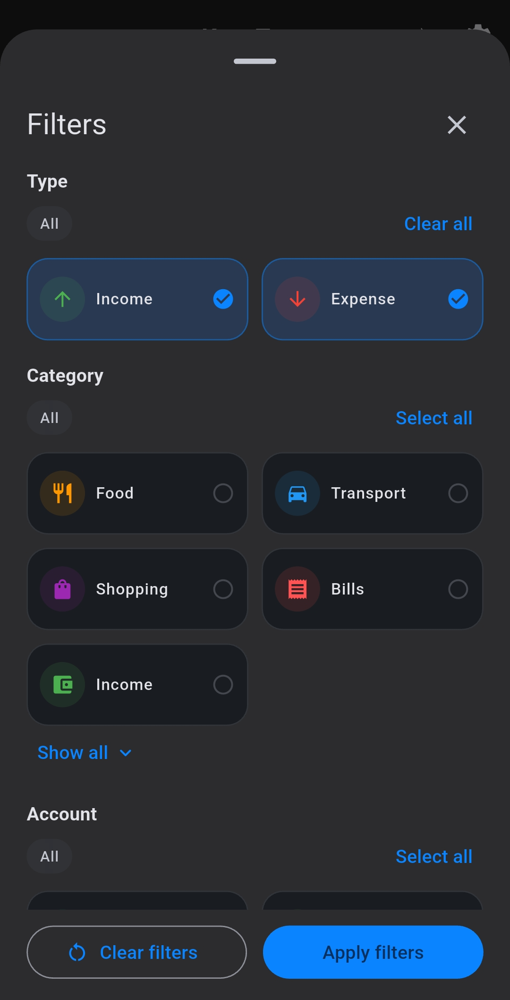
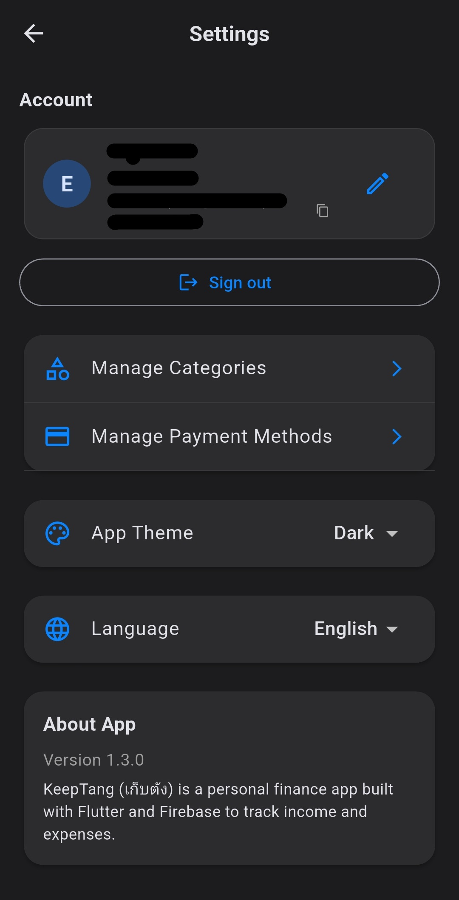
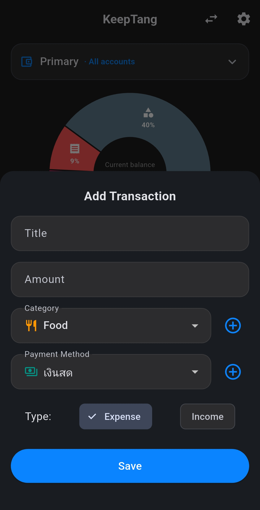
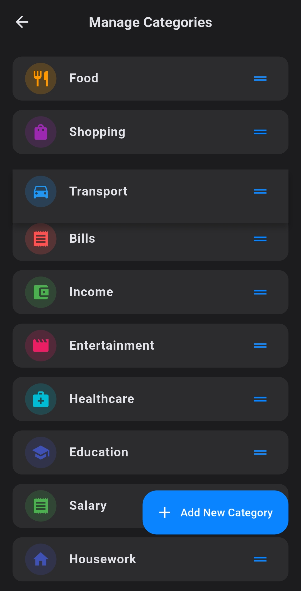
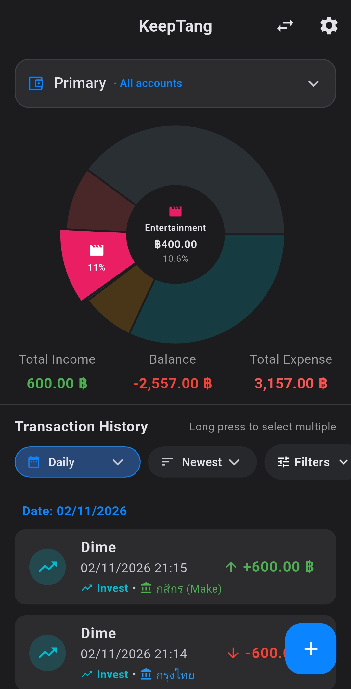
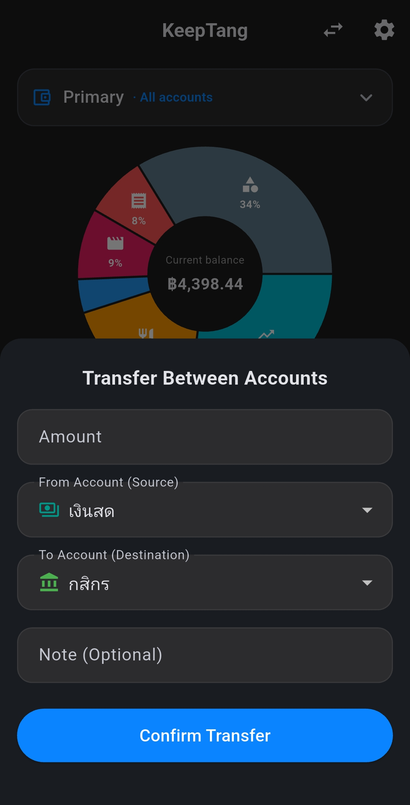

# KeepTang (เก็บตัง)

**เห็นภาพการเงินชัดขึ้น เริ่มได้จากการจดทุกวัน**

แอปพลิเคชันบันทึกรายรับ–รายจ่ายที่ช่วยให้การจัดการเงินเป็นเรื่องง่ายและไม่ซับซ้อน

  
  
  
  

---

##  ภาพรวมแอปพลิเคชัน (Screenshots)

*ปัดหรือเลื่อนแนวนอนเพื่อดูภาพหน้าจอทั้งหมด (Horizontal Scroll)*

<table>
  <tr>
    <td align="center"> Dashboard (แยกบัญชี)</td>
    <td align="center"> ธีมสว่าง & มืด</td>
    <td align="center"> ตัวกรองรายการ</td>
    <td align="center"> ตั้งค่าแอปพลิเคชัน</td>
    <td align="center"> เพิ่มและแก้ไขรายการ</td>
    <td align="center"> จัดการหมวดหมู่</td>
    <td align="center"> เจาะดูแต่ละหมวดหมู่</td>
    <td align="center"> โอนเงินระหว่างบัญชี</td>
  </tr>
</table>

##  จัดการเงินให้ง่ายขึ้นในทุกวัน

KeepTang คือแอปพลิเคชันจดรายรับและรายจ่ายสำหรับผู้ที่ต้องการติดตามกระแสเงินสด โดยออกแบบระบบให้ใช้งานง่าย ไม่ซับซ้อน สามารถเปิดแอปพลิเคชันและเริ่มบันทึกได้ทันที พร้อม Dashboard ที่ช่วยสรุปข้อมูลให้อ่านง่ายในมุมมองเดียว

เหมาะสำหรับการติดตามค่าใช้จ่ายส่วนตัว การแยกเงินตามบัญชีหรือช่องทางชำระเงิน และการทบทวนพฤติกรรมการใช้เงินในแต่ละช่วงเวลา

##  ฟีเจอร์เด่น (Key Features)

* **บันทึกรายการคล่องตัว** — เพิ่ม แก้ไข ลบ และยกเลิกการลบรายการได้อย่างรวดเร็ว
* **Dashboard แสดงภาพรวม** — ดูยอดรายรับ รายจ่าย ยอดคงเหลือ และกราฟแยกตามหมวดหมู่ได้อย่างชัดเจน
* **จัดการบัญชีและช่องทางชำระเงิน** — สลับดูข้อมูลแต่ละบัญชี หรือดูภาพรวมจากบัญชีหลักทั้งหมด
* **จัดการหลายรายการ (Multi-select)** — เลือกหลายรายการพร้อมกันเพื่อดูยอดรวม หรือแก้ไขหมวดหมู่และช่องทางชำระเงินในคราวเดียว
* **ระบบกรองและจัดระเบียบ** — กรองตามประเภทรายการ หมวดหมู่ และช่องทางชำระเงิน พร้อมการจัดกลุ่มและเรียงลำดับ
* **ปรับแต่งได้ตามต้องการ** — เพิ่มหมวดหมู่ เลือกไอคอน กำหนดสี และจัดลำดับการแสดงผลได้อย่างอิสระ
* **รองรับหลายภาษาและธีม** — ใช้งานได้ทั้งภาษาไทย ภาษาอังกฤษ พร้อมรองรับธีมสว่าง (Light) และธีมมืด (Dark)
* **ส่งออกข้อมูล (Export)** — รองรับการนำข้อมูลออกในรูปแบบ CSV และรายงาน PDF
* **เข้าใช้งานแบบ Guest** — เริ่มต้นจดบันทึกได้ทันทีโดยไม่จำเป็นต้องสมัครสมาชิก

##  เทคโนโลยีที่ใช้ (Tech Stack)

| เทคโนโลยี | การนำมาใช้งาน | 
| :--- | :--- | 
| **Flutter · Dart** | พัฒนาแอปพลิเคชันและส่วนติดต่อผู้ใช้งาน (UI) | 
| **Firebase Core · Cloud Firestore** | เชื่อมต่อระบบฐานข้อมูลเพื่อจัดเก็บรายการ | 
| **SharedPreferences** | บันทึกการตั้งค่าบนอุปกรณ์ เช่น ภาษาและธีม | 
| **FL Chart** | แสดงผลกราฟสถิติบนหน้า Dashboard | 

##  สิ่งที่ได้เรียนรู้จากการพัฒนา (What I Learned)

โปรเจกต์นี้เป็นพื้นที่สำหรับฝึกฝนการออกแบบและพัฒนาแอปพลิเคชันการเงินอย่างครบวงจร ตั้งแต่การจัดการโครงสร้างข้อมูล การเชื่อมต่อฐานข้อมูล Firestore การพัฒนา Dashboard ไปจนถึงการสร้างกราฟและตัวกรอง นอกจากนี้ การพัฒนาฟีเจอร์ Multi-select ยังช่วยเสริมสร้างทักษะด้านการจัดการ State การประมวลผลยอดรวม และการอัปเดตข้อมูลจำนวนมากให้ทำงานได้อย่างมีประสิทธิภาพและราบรื่น

##  ติดต่อและติดตาม (Contact)

* **GitHub Profile:** [thanakorn-official](https://github.com/thanakorn-official)
* **Project Repository:** [KeepTang Source Code](https://github.com/thanakorn-official/KeepTang)

---

> [!WARNING]
>
> **หมายเหตุด้านความปลอดภัยและการใช้งาน**
>
> KeepTang ในเวอร์ชันนี้ใช้ระบบ Guest ID ซึ่งจัดเก็บข้อมูลไว้บนอุปกรณ์ และยังไม่มีระบบบัญชีเพื่อกู้คืนข้อมูลข้ามเครื่อง นอกจากนี้ กฎ `firestore.rules` ใน Repository ปัจจุบัน อนุญาตให้อ่านและเขียนข้อมูลโดยไม่ผ่านการยืนยันตัวตน (Authentication) **โปรเจกต์นี้จึงเหมาะสำหรับการสาธิตและทดลองใช้งานเท่านั้น** หากต้องการนำไปใช้งานกับข้อมูลจริง ควรพิจารณาเพิ่มระบบยืนยันตัวตนและตั้งค่า Firestore Security Rules ให้มีความรัดกุมมากยิ่งขึ้น
