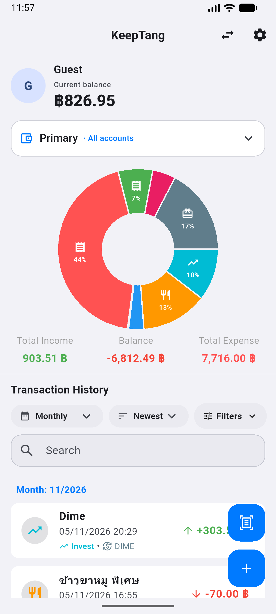
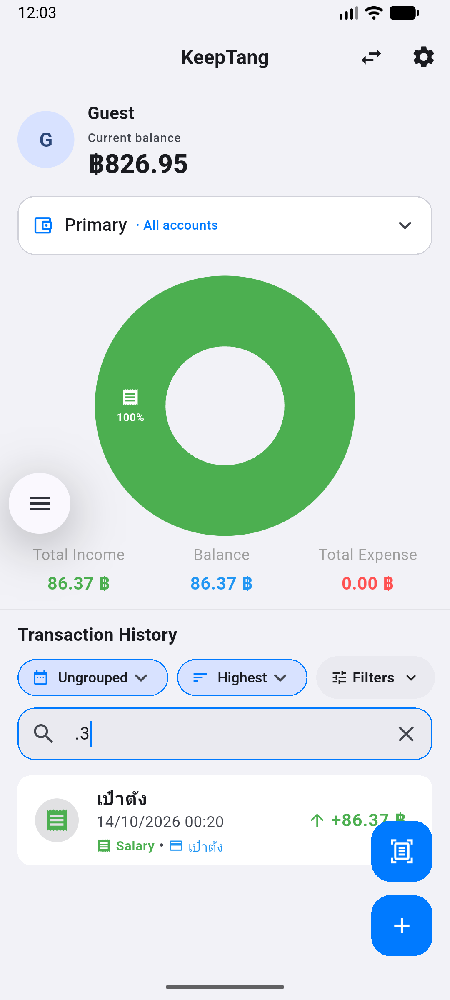

<div align="center">
  
  <p><strong>บันทึกรายรับ รายจ่าย และการโอนเงินในที่เดียว</strong></p>
  <p>ดูยอดคงเหลือ แยกบัญชีตามที่ใช้จริง และเพิ่มรายการจากสลิปได้</p>
  <p>
    <a href="https://github.com/thanakorn-official/KeepTang/releases/download/1.4.6/KeepTang-1.4.6.apk"></a>
    <a href="https://github.com/thanakorn-official/KeepTang/releases"></a>
  </p>
  <p>
    <a href="#ฟังก์ชัน">ฟังก์ชัน</a> ·
    <a href="#ภาพตัวอย่าง">ภาพตัวอย่าง</a> ·
    <a href="#สิ่งที่ใช้">สิ่งที่ใช้</a> ·
    <a href="#โครงสร้างโปรเจกต์">โครงสร้าง</a> ·
    <a href="#ข้อควรระวัง">ข้อควรระวัง</a>
  </p>
</div>

---

## ดาวน์โหลด APK

**KeepTang 1.4.6 สำหรับ Android** · [ดาวน์โหลด KeepTang-1.4.6.apk](https://github.com/thanakorn-official/KeepTang/releases/download/1.4.6/KeepTang-1.4.6.apk) · [ดูทุกเวอร์ชัน](https://github.com/thanakorn-official/KeepTang/releases)

## ฟังก์ชัน

| ฟังก์ชัน | ทำอะไรได้บ้าง |
| --- | --- |
| **บันทึกรายการ** | เพิ่มหรือแก้ไขรายรับ รายจ่าย และการโอนระหว่างบัญชี |
| **แดชบอร์ด** | ดูยอดคงเหลือและกราฟรายรับรายจ่ายตามช่วงเวลาและหมวดหมู่ |
| **เพิ่มจากสลิป** | ดึงยอดเงิน วันที่ เวลา และเลขอ้างอิงจากภาพ แล้วตรวจแก้ก่อนบันทึก |
| **ค้นหาและจัดการรายการ** | ค้นหาด้วยชื่อ เลขอ้างอิง หรือ Firebase ID กรอง เรียงลำดับ และจัดการหลายรายการได้ |
| **บัญชีของฉันและหมวดหมู่** | แยกเงินสดออกจากบัญชีธนาคาร และใช้ไอคอนช่วยแยกหมวดหมู่ |
| **ถังขยะและส่งออก** | กู้คืนรายการที่ลบ และส่งออกข้อมูลเป็น CSV หรือรายงาน PDF |
| **บัญชีสมาชิก** | สมัครและเข้าสู่ระบบด้วยอีเมล ขอลิงก์ตั้งรหัสผ่านใหม่ หรือกลับเข้าโหมด Guest ด้วย ID เดิม |
| **หน้าตาแอป** | รองรับภาษาไทยและอังกฤษ พร้อมธีมสว่างและมืด |

## ภาพตัวอย่าง

กดภาพเพื่อดูขนาดเต็ม

<div align="center">
  <table>
    <tr>
      <td align="center"><a href="./screenshot/Dashboard.png"></a><br /><strong>แดชบอร์ด</strong></td>
      <td align="center"><a href="./screenshot/AddTransaction.png"></a><br /><strong>เพิ่มรายการ</strong></td>
      <td align="center"><a href="./screenshot/SlipAdd.png"></a><br /><strong>อ่านสลิป</strong></td>
    </tr>
    <tr>
      <td align="center"><a href="./screenshot/Search.png"></a><br /><strong>ค้นหา</strong></td>
      <td align="center"><a href="./screenshot/Categories.png"></a><br /><strong>หมวดหมู่</strong></td>
      <td align="center"><a href="./screenshot/Setting.png"></a><br /><strong>ตั้งค่า</strong></td>
    </tr>
  </table>
</div>

## สิ่งที่ใช้

| ส่วนของแอป | เทคโนโลยี |
| --- | --- |
| หน้าจอและฟอร์ม | Flutter · Dart |
| ระบบบัญชีและฐานข้อมูล | Firebase Authentication · Cloud Firestore |
| อ่านข้อความจากสลิป | Google ML Kit · Tesseract OCR สำหรับภาษาไทยบน Android |
| กราฟและการตั้งค่าในเครื่อง | FL Chart · SharedPreferences |

## โครงสร้างโปรเจกต์

```text
KeepTang/
├── lib/
│   ├── main.dart       จุดเริ่มของแอป
│   ├── screens/        หน้าจอสมาชิก แดชบอร์ด และตั้งค่า
│   ├── services/       บัญชี อ่านสลิป และส่งออกข้อมูล
│   ├── models/         โครงสร้างข้อมูลรายการ
│   ├── widgets/        ส่วนประกอบหน้าจอที่ใช้ซ้ำ
│   └── utils/          ภาษาและธีม
├── android/            ส่วน Android และโมเดล OCR
├── assets/branding/    โลโก้และภาพแบรนด์
├── screenshot/         ภาพหน้าจอตัวอย่าง
├── test/               ชุดทดสอบ
├── firestore.rules     กฎการเข้าถึงข้อมูล
└── pubspec.yaml        เวอร์ชันและแพ็กเกจที่ใช้
```

## ข้อควรระวัง

- **อ่านสลิป:** ตรวจยอดเงิน วันที่ เวลา และเลขอ้างอิงก่อนบันทึก OCR อาจอ่านคลาดเคลื่อนเมื่อภาพไม่ชัด หรือสลิปแสดงรหัสมาเพียงบางส่วน
- **โหมด Guest:** กฎเดิมอนุญาตให้อ่านและเขียนข้อมูล Guest โดยไม่ต้องยืนยันตัวตน โหมดนี้เหมาะกับการสาธิตและข้อมูลทดสอบ
- **บัญชีสมาชิก:** ข้อมูล Guest และสมาชิกอยู่คนละพื้นที่ บัญชีอีเมลต้องเปิด Email/Password และใช้ [กฎ Firestore ของโปรเจกต์](./firestore.rules) บน Firebase ที่แอปเชื่อมต่อ

## ผู้พัฒนา

พัฒนาโดย **[thanakorn-official](https://github.com/thanakorn-official)** · [GitHub Repository](https://github.com/thanakorn-official/KeepTang)
