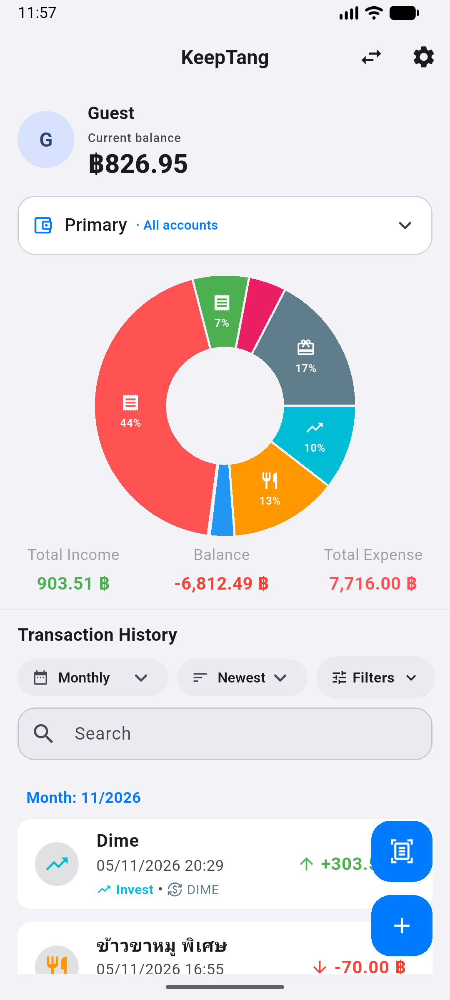
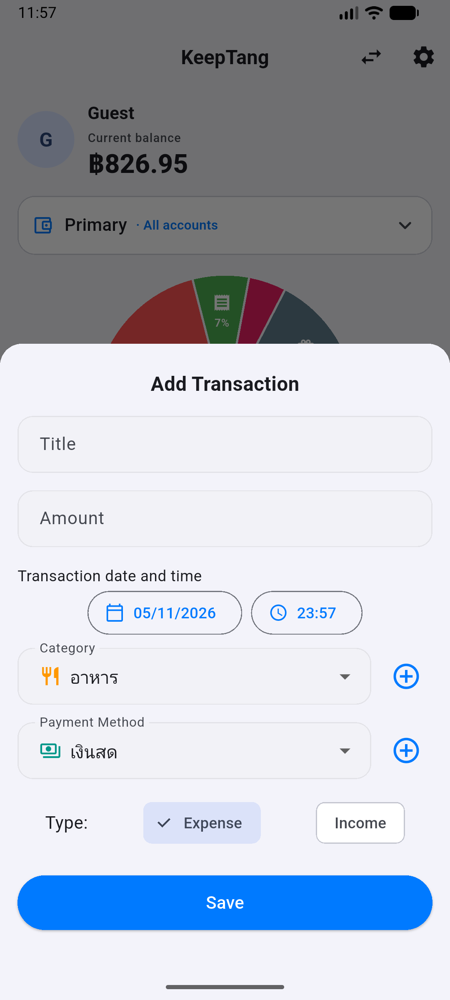
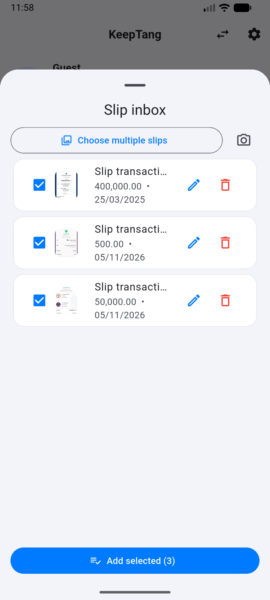
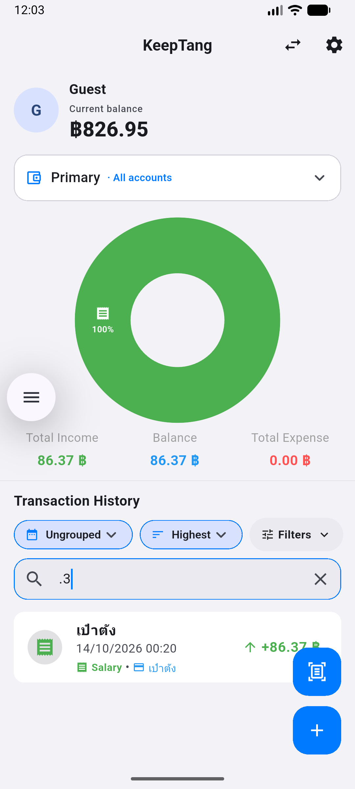

<div align="center">


# KeepTang (เก็บตัง)

**บันทึกรายรับ–รายจ่าย เห็นภาพรวมการเงินได้ในที่เดียว**

แอปจัดการการเงินส่วนบุคคลที่ช่วยให้การจดรายการ ติดตามยอดเงิน และทบทวนพฤติกรรมการใช้จ่ายเป็นเรื่องง่าย

<p>
  
  
  
  
</p>

[คุณสมบัติ](#คุณสมบัติ) · [ภาพหน้าจอ](#ภาพหน้าจอ) · [เริ่มต้นใช้งาน](#เริ่มต้นใช้งาน) · [เทคโนโลยี](#เทคโนโลยี)

</div>

---

## คุณสมบัติ

| | คุณสมบัติ | รายละเอียด |
|---|---|---|
| 📊 | **Dashboard การเงิน** | ดูรายรับ รายจ่าย ยอดคงเหลือ และกราฟแยกตามหมวดหมู่ |
| ✍️ | **จัดการรายการ** | เพิ่ม แก้ไข ลบ และเรียกคืนรายการ พร้อมกำหนดวันและเวลา |
| 🧾 | **บันทึกจากสลิป** | อ่านยอดเงิน วันที่ และเลขรายการจากภาพสลิป พร้อมตรวจแก้ก่อนบันทึก |
| 🔎 | **ค้นหาและตัวกรอง** | ค้นหารายการและกรองตามหมวดหมู่ ช่องทางชำระเงิน หรือช่วงเวลา |
| ☑️ | **จัดการหลายรายการ** | เลือกหลายรายการเพื่อแก้วันเวลา หมวดหมู่ หรือช่องทางชำระเงินพร้อมกัน |
| 💳 | **แยกบัญชีและโอนเงิน** | ดูยอดตามบัญชีหรือช่องทางชำระเงิน และบันทึกการโอนระหว่างบัญชี |
| 🎨 | **ปรับแต่งตามต้องการ** | จัดการหมวดหมู่ ไอคอน และช่องทางชำระเงิน |
| 🌗 | **ใช้งานได้ตามสไตล์** | เลือกภาษาไทยหรืออังกฤษ และธีมสว่างหรือมืด |
| 📤 | **นำข้อมูลออก** | ส่งออกรายการเป็น CSV หรือรายงาน PDF |

## ภาพหน้าจอ

<div align="center">
<table>
  <tr>
    <td align="center">
      <a href="./screenshot/Dashboard.png"></a><br />
      <strong>Dashboard</strong><br /><sub>ภาพรวมบัญชี ยอดเงิน และประวัติรายการ</sub>
    </td>
    <td align="center">
      <a href="./screenshot/AddTransaction.png"></a><br />
      <strong>เพิ่มรายการ</strong><br /><sub>บันทึกรายรับหรือรายจ่ายพร้อมวันเวลา</sub>
    </td>
  </tr>
  <tr>
    <td align="center">
      <a href="./screenshot/SlipAdd.png"></a><br />
      <strong>เพิ่มรายการจากสลิป</strong><br /><sub>ตรวจสอบสลิปและเลือกเพิ่มหลายรายการ</sub>
    </td>
    <td align="center">
      <a href="./screenshot/Search.png"></a><br />
      <strong>ค้นหาและจัดเรียง</strong><br /><sub>ค้นหาและเรียงรายการตามต้องการ</sub>
    </td>
  </tr>
</table>
</div>

## เริ่มต้นใช้งาน

### สิ่งที่ต้องมี

- Flutter SDK และ Dart SDK
- Android Studio หรืออุปกรณ์สำหรับรันแอป Flutter
- โปรเจกต์ Firebase ที่ตั้งค่า Cloud Firestore แล้ว

### รันบนเครื่อง

```bash
git clone https://github.com/thanakorn-official/KeepTang.git
cd KeepTang
flutter pub get
flutter run
```

การเชื่อมต่อ Firebase ต้องตั้งค่าไฟล์ของโปรเจกต์ก่อนรัน เช่น `lib/firebase_options.dart` และ `android/app/google-services.json` ไฟล์กำหนดค่าเหล่านี้ไม่ได้รวมอยู่ใน repository

## เทคโนโลยี

- **Flutter และ Dart** — แอปพลิเคชันและส่วนติดต่อผู้ใช้
- **Firebase Cloud Firestore** — จัดเก็บข้อมูลรายการ
- **Google ML Kit Text Recognition** — อ่านข้อความจากภาพสลิป
- **SharedPreferences** — เก็บค่าตั้งค่าบนอุปกรณ์
- **FL Chart** — แสดงกราฟสรุปข้อมูล

## ข้อควรทราบด้านความปลอดภัย

โหมด Guest ใช้ ID เฉพาะอุปกรณ์เพื่อแยกข้อมูล และยังไม่มีระบบบัญชีสำหรับกู้คืนข้อมูลข้ามเครื่อง นอกจากนี้ [Firestore Security Rules](./firestore.rules) ใน repository อนุญาตให้อ่านและเขียนข้อมูลในคอลเลกชัน Guest โดยไม่ยืนยันตัวตน โปรเจกต์นี้จึงเหมาะสำหรับทดลองหรือสาธิตเท่านั้น **ไม่ควรใช้เก็บข้อมูลการเงินจริง** จนกว่าจะเพิ่มระบบยืนยันตัวตนและกำหนดกฎความปลอดภัยให้เหมาะสม

---

<div align="center">

พัฒนาโดย [thanakorn-official](https://github.com/thanakorn-official) · [ดูซอร์สโค้ด](https://github.com/thanakorn-official/KeepTang)

</div>
