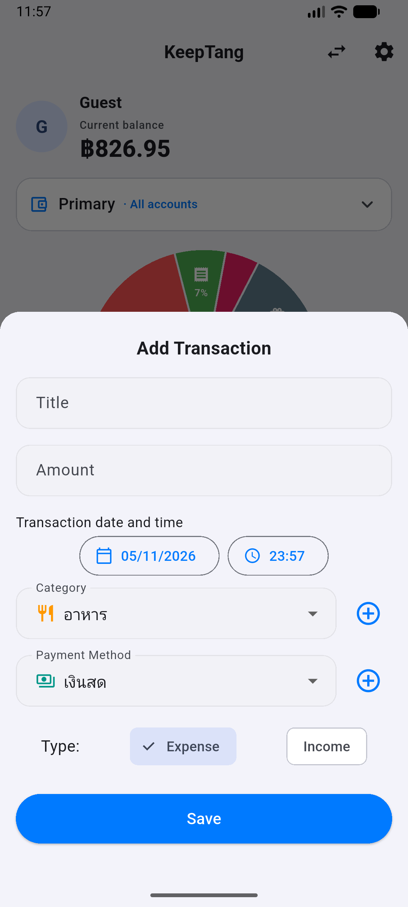
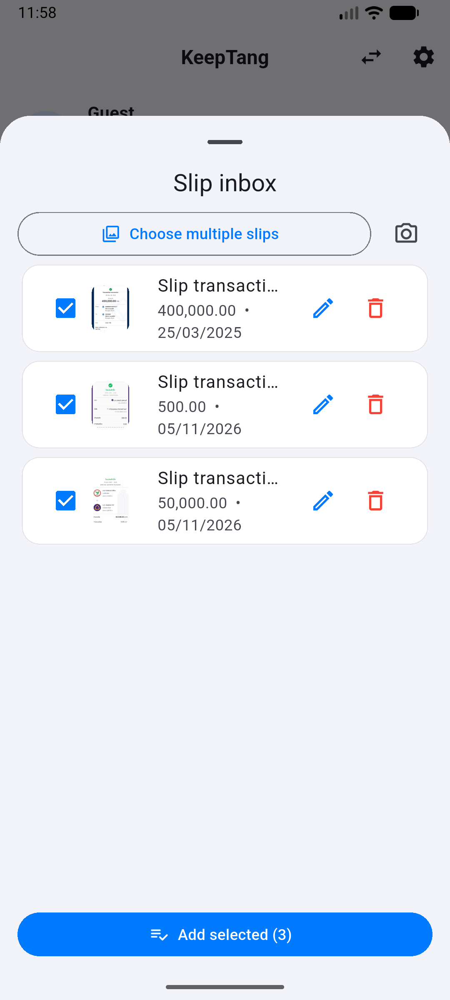

<div align="center">
  

  <h1>เก็บตัง · KeepTang</h1>
  <p><strong>เห็นภาพการเงินในแต่ละวัน จัดการรายการได้ง่ายขึ้น</strong></p>

  <p>
    
    
    
  </p>

  <p>
    <a href="#ภาพตัวอย่าง">ภาพตัวอย่าง</a> ·
    <a href="#เริ่มต้นใช้งาน">เริ่มต้นใช้งาน</a> ·
    <a href="https://github.com/thanakorn-official/KeepTang">ซอร์สโค้ด</a>
  </p>
</div>

---

## เกี่ยวกับแอป

KeepTang เป็นแอป Flutter สำหรับบันทึกรายรับ รายจ่าย และการโอนเงิน ช่วยดูยอดคงเหลือ ค้นหารายการย้อนหลัง และจัดข้อมูลตามบัญชีหรือหมวดหมู่ ใช้ได้ทั้งภาษาไทยและภาษาอังกฤษ พร้อมธีมสว่างและมืด

## ความสามารถ

| | ฟีเจอร์ |
|:--:|---|
| 💸 | เพิ่มและแก้ไขรายการรายรับ รายจ่าย รวมถึงการโอนระหว่างบัญชี |
| 📊 | ดูยอดคงเหลือและสรุปการใช้จ่ายตามช่วงเวลาและหมวดหมู่ |
| 🔎 | ค้นหา กรอง เรียงลำดับ และเลือกจัดการหลายรายการ |
| 🧾 | อ่านข้อมูลจากภาพสลิป เช่น ยอดเงิน วันที่ เวลา และรหัสอ้างอิง พร้อมให้ตรวจทานก่อนบันทึก |
| 🗂️ | จัดการบัญชี หมวดหมู่ และไอคอนประกอบรายการ |
| ↩️ | ย้ายรายการไปถังขยะและกู้คืนรายการที่ลบได้ |
| 📤 | ส่งออกข้อมูลเป็น CSV และรายงาน PDF |
| 🌗 | เลือกภาษาไทยหรืออังกฤษ และปรับธีมสว่างหรือมืด |

> การอ่านสลิปภาษาไทยใช้โมเดล OCR ภายในเครื่องบน Android ส่วนการอ่านข้อความและรูปแบบที่อ่านได้อาจแตกต่างกันตามคุณภาพของภาพ ธนาคาร และรูปแบบสลิป ควรตรวจทานข้อมูลก่อนบันทึกทุกครั้ง

## ภาพตัวอย่าง

<div align="center">
  <table>
    <tr>
      <td align="center"><a href="./screenshot/Dashboard.png"></a><br /><strong>แดชบอร์ด</strong></td>
      <td align="center"><a href="./screenshot/AddTransaction.png"></a><br /><strong>เพิ่มรายการ</strong></td>
      <td align="center"><a href="./screenshot/SlipAdd.png"></a><br /><strong>อ่านสลิป</strong></td>
    </tr>
    <tr>
      <td align="center"><a href="./screenshot/Categories.png"></a><br /><strong>หมวดหมู่</strong></td>
      <td align="center"><a href="./screenshot/Search.png"></a><br /><strong>ค้นหา</strong></td>
      <td align="center"><a href="./screenshot/Setting.png"></a><br /><strong>ตั้งค่า</strong></td>
    </tr>
  </table>
</div>

## เทคโนโลยี

- **แอป:** Flutter และ Dart
- **ฐานข้อมูล:** Firebase Cloud Firestore
- **อ่านสลิป:** Google ML Kit และ Tesseract OCR สำหรับภาษาไทยบน Android
- **กราฟ:** FL Chart
- **การตั้งค่าในเครื่อง:** SharedPreferences

## เริ่มต้นใช้งาน

ต้องติดตั้ง Flutter SDK, Android SDK และ Java 17 ก่อน จากนั้นเปิดเทอร์มินัลที่โฟลเดอร์โปรเจกต์

```bash
flutter pub get
flutter run
```

โปรเจกต์ต้องตั้งค่า Firebase สำหรับแพลตฟอร์มที่จะใช้งานไว้แล้ว

### สร้าง APK สำหรับ Android

```bash
flutter build apk --release
```

ไฟล์ APK จะอยู่ที่ `build/app/outputs/flutter-apk/app-release.apk` เวอร์ชันแอปกำหนดไว้ใน `pubspec.yaml` โดยเลขก่อน `+` คือชื่อเวอร์ชัน และเลขหลัง `+` คือ build number

## โครงสร้างโปรเจกต์

```text
lib/                    โค้ดแอป โมเดล หน้าจอ และบริการ
android/                โปรเจกต์และส่วน OCR สำหรับ Android
assets/branding/        โลโก้และภาพแบรนด์
screenshot/             ภาพหน้าจอตัวอย่าง
test/                   ชุดทดสอบ
firestore.rules         กฎ Firestore
pubspec.yaml            เวอร์ชันและ dependencies
```

## หมายเหตุเรื่องข้อมูล

แอปใช้ Guest ID เพื่อแยกข้อมูลใน Firestore และยังไม่มีระบบบัญชีสำหรับกู้คืนข้อมูลข้ามอุปกรณ์ กฎ Firestore ปัจจุบันอนุญาตให้อ่านและเขียนข้อมูลในพื้นที่ Guest ได้โดยใช้ Guest ID ดังนั้นผู้ที่ทราบ ID อาจเข้าถึงข้อมูลนั้นได้ เหมาะกับการทดลองหรือสาธิต ควรปรับกฎและเพิ่มระบบยืนยันตัวตนก่อนใช้เก็บข้อมูลส่วนตัวจริง

## ผู้พัฒนา

พัฒนาโดย [thanakorn-official](https://github.com/thanakorn-official) · [ดูซอร์สโค้ดบน GitHub](https://github.com/thanakorn-official/KeepTang)

<div align="center">
  <sub>KeepTang — Keep track of your money, one day at a time.</sub>
</div>
